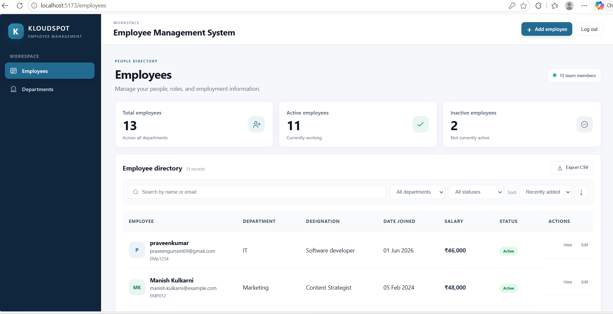
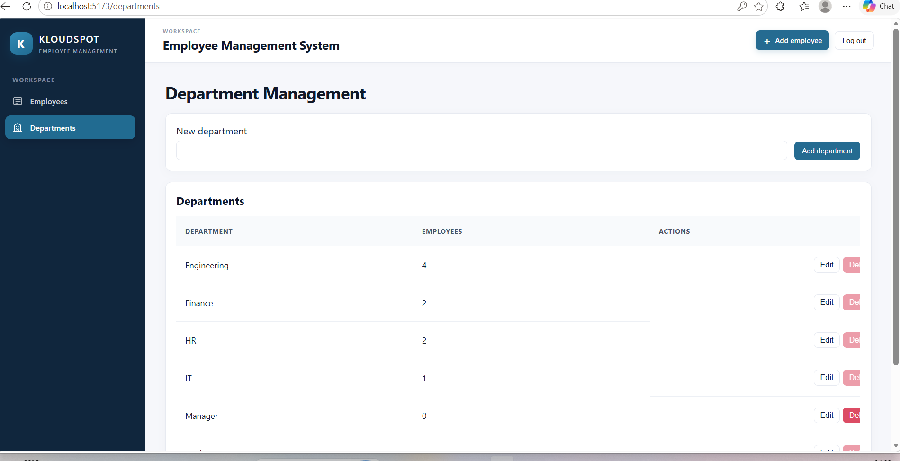
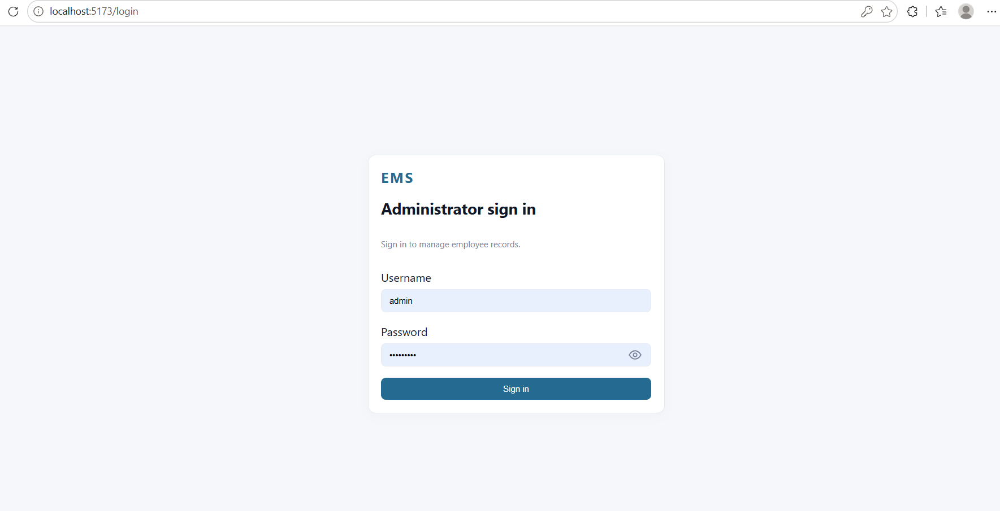

# Employee Management System

A full-stack employee directory and administration application built with React, Spring Boot, and MySQL. Manage employee records, organize departments, search and filter the directory, and export matching records to CSV.

> **GitHub landing page:** This README is at the repository root, so it appears automatically when you open the project on GitHub. The application source is in [`employee-management-system/`](./employee-management-system/).

## Contents

- [Features](#features)
- [Screenshots](#screenshots)
- [Technology stack](#technology-stack)
- [Quick start with Docker Compose](#quick-start-with-docker-compose-recommended)
- [Run without Docker](#run-without-docker)
- [Configuration](#configuration)
- [API overview](#api-overview)
- [Tests](#tests)
- [Troubleshooting](#troubleshooting)
- [Security notes](#security-notes)
- [Project structure](#project-structure)

## Features

- Paginated, sortable employee directory with search by name or email.
- Filter employees by department and employment status.
- Create, view, edit, and delete employees with client- and server-side validation.
- Dashboard counts for total, active, and inactive employees.
- Department management: create, rename, and delete unused departments. Renaming a department updates its employees.
- CSV export includes all records matching the selected filters, not only the current page.
- Administrator sign-in and authentication-protected employee and department API endpoints.
- Docker Compose setup to run the database, API, and web application together.

## Screenshots

Screenshots are stored in [`employee-management-system/docs/screenshots/`](./employee-management-system/docs/screenshots/).

| Employee dashboard | Department management | Sign-in |
|---|---|---|
|  |  |  |

## Technology stack

| Area | Technologies |
|---|---|
| Frontend | React 18, Vite, React Router, Axios |
| Backend | Java 17, Spring Boot 3.5, Spring Web, Spring Data JPA, Spring Security, Jakarta Validation |
| Database | MySQL 8 |
| API documentation | springdoc OpenAPI / Swagger UI |
| Tests | JUnit 5, Mockito, Vitest, React Testing Library, Playwright |
| Local orchestration | Docker Compose |

## Quick start with Docker Compose (recommended)

This is the simplest way to run the full application. Install and start Docker Desktop first. You do not need to install Java, Maven, Node.js, or MySQL separately.

### 1. Clone the repository

In PowerShell:

```powershell
git clone https://github.com/gurram-praveen/Employee-Management-system.git
cd .\Employee-Management-system\employee-management-system
```

If the repository is already cloned and your terminal is at its root, just enter the application directory:

```powershell
cd .\employee-management-system
```

### 2. Build and start the application

```powershell
docker compose up --build
```

On the first run, Docker downloads the required images and builds the backend and frontend. Once the services are ready, open **http://localhost:5173**.

Local development sign-in:

| Username | Password |
|---|---|
| `admin` | `change-me` |

These are local-only defaults. Do not use them for an internet-accessible deployment.

### 3. Stop the application

Press `Ctrl+C` in the Compose terminal, then run:

```powershell
docker compose down
```

The database is kept in a Docker volume when the services stop. This command removes the volume and permanently deletes its data:

```powershell
docker compose down --volumes
```

### Customize local Docker settings (optional)

Compose has local development defaults, so `.env` is not required for the quick start. To customize them, copy the example file, edit the values, and then start Compose:

```powershell
Copy-Item .env.example .env
```

Keep `.env` private and do not commit it. The database username and password must match between the MySQL and backend configuration.

## Run without Docker

This setup runs MySQL, the backend, and the frontend as separate local processes.

### Prerequisites

- JDK 17
- Maven 3.9 or later
- Node.js 18 or later with npm
- MySQL 8

Check your installed versions:

```powershell
java -version
mvn -v
node -v
npm -v
mysql --version
```

In the commands below, run from the `employee-management-system` application directory inside the cloned repository.

### 1. Create and seed the database

Start MySQL and run this command from PowerShell:

```powershell
cmd /c "mysql -u root -p < database\schema.sql"
```

Enter the MySQL root password when prompted. The script creates the `employee_db` database, both tables, department data, and 12 sample employees. Use it to initialize a fresh local database; it is not intended to reinsert sample employees into a database that already has them.

If you have an existing database created before department management was added, apply the department migration once instead:

```powershell
cmd /c "mysql -u root -p < database\department-migration.sql"
```

The backend validates the schema at startup; it does not create or update tables automatically.

### 2. Start the backend

Open a PowerShell terminal in the application directory:

```powershell
Set-Location .\backend
$env:DB_USERNAME = "root"
$env:DB_PASSWORD = "your_mysql_password"
$env:ADMIN_USERNAME = "admin"
$env:ADMIN_PASSWORD = "choose_a_local_password"
mvn spring-boot:run
```

Replace `your_mysql_password` with your MySQL password. If your local MySQL root account has no password, set `$env:DB_PASSWORD = ""`. Leave this terminal running.

### 3. Start the frontend

Open a second PowerShell terminal in the application directory:

```powershell
Set-Location .\frontend
npm ci
npm run dev
```

Open **http://localhost:5173** and sign in with the `ADMIN_USERNAME` and `ADMIN_PASSWORD` configured for the backend. Keep MySQL and both application terminals running.

The frontend's API URL defaults to `http://localhost:8080/api`. To use another address, copy `frontend/.env.example` to `frontend/.env`, set `VITE_API_BASE_URL`, and restart Vite.

## Configuration

The backend reads these values from environment variables. Compose supplies local defaults for its services; for a manual setup, set the variables in the backend terminal.

| Variable | Local default / purpose |
|---|---|
| `DB_URL` | `jdbc:mysql://localhost:3306/employee_db?useSSL=false&allowPublicKeyRetrieval=true&serverTimezone=UTC` |
| `DB_USERNAME` | `root` for manual setup; `ems_app` in Compose |
| `DB_PASSWORD` | MySQL password; empty by default for manual setup |
| `DDL_AUTO` | `validate` (the application validates but does not create or update tables) |
| `CORS_ORIGINS` | `http://localhost:5173,http://localhost:3000` |
| `ADMIN_USERNAME` | `admin` for local development |
| `ADMIN_PASSWORD` | `change-me` for local Compose development |
| `VITE_API_BASE_URL` | `http://localhost:8080/api` |

The production Spring profile has no credential defaults. Provide database, administrator, and CORS settings through your deployment's secret-management system. `VITE_API_BASE_URL` is compiled into the frontend when it is built.

## API overview

API base URL: `http://localhost:8080/api`. The login endpoint checks the configured administrator credentials. Other employee and department endpoints require HTTP Basic authentication.

| Method | Endpoint | Description |
|---|---|---|
| `POST` | `/auth/login` | Validate administrator credentials |
| `GET` | `/employees` | List employees with pagination, search, filters, and sorting |
| `POST` | `/employees` | Create an employee |
| `GET` | `/employees/{id}` | Get employee details |
| `PUT` | `/employees/{id}` | Update an employee |
| `DELETE` | `/employees/{id}` | Delete an employee |
| `GET` | `/employees/summary` | Total, active, and inactive counts |
| `GET` | `/employees/departments` | Department names for employee filters |
| `GET` | `/employees/export` | Export matching employees as CSV |
| `GET` | `/departments` | List departments and employee counts |
| `POST` | `/departments` | Create a department |
| `PUT` | `/departments/{id}` | Rename a department and update employee assignments |
| `DELETE` | `/departments/{id}` | Delete a department with no assigned employees |

The employee list accepts `page`, `size`, `search`, `department`, `status`, `sortBy`, and `direction` query parameters. Validation errors include field details; duplicate records return a conflict response.

In the development profile, Swagger UI is available at **http://localhost:8080/swagger-ui.html**. Swagger/OpenAPI is disabled in the production profile. The Postman collection is at [`employee-management-system/docs/EMS.postman_collection.json`](./employee-management-system/docs/EMS.postman_collection.json); set its `adminUsername` and `adminPassword` variables to match the backend.

## Tests

Run backend unit tests (no running database required):

```powershell
Set-Location .\backend
mvn test
```

Run frontend unit tests and build the production bundle:

```powershell
Set-Location .\frontend
npm ci
npm test
npm run build
```

Playwright end-to-end tests are in `frontend/e2e/`. They require the application and database to be running and a Playwright browser to be installed. See [`employee-management-system/docs/TEST_CHECKLIST.md`](./employee-management-system/docs/TEST_CHECKLIST.md) for manual verification.

## Troubleshooting

| Problem | What to check |
|---|---|
| Docker cannot connect to its engine | Start Docker Desktop, wait until it has finished starting, and retry `docker compose up --build`. |
| Port 3306, 8080, or 5173 is already in use | Stop the other process using the port or change the relevant port mapping/configuration. |
| Backend cannot connect to MySQL | Check that MySQL is running, the database exists, and the connection settings and credentials are correct. |
| Backend reports a schema validation error | Check that the schema was initialized; apply `database/department-migration.sql` to an older database. |
| Frontend loads but sign-in or API calls fail | Make sure the backend is running on port 8080 and the frontend API URL points to it. |
| Maven reports an unsupported Java version | Check that `mvn -v` reports Java 17 or later and uses the expected JDK. |
| PowerShell errors on `<` in a MySQL command | Use the documented `cmd /c "mysql ... < database\schema.sql"` form. |

## Security notes

This project is for local development and assessment use; do not expose the default Compose configuration directly to the public internet. The default administrator and database credentials are intentionally for local use. Authentication uses one in-memory administrator and HTTP Basic; the browser stores credentials in tab-scoped session storage. Production use requires an appropriate identity solution, HTTPS, managed secrets, a secured database, restricted CORS origins, monitoring, rate limiting, backups, and a privacy/data-retention review.

## Project structure

```text
repository/
├── .gitignore
├── README.md                         GitHub landing page and full setup guide
└── employee-management-system/
    ├── backend/                      Spring Boot API and unit tests
    ├── database/                     MySQL schema and department migration
    ├── docs/                         Postman collection, checklist, screenshots
    ├── frontend/                     React/Vite app and tests
    ├── docker-compose.yml            Local MySQL, backend, and frontend
    └── README.md                     Link to this guide
```

## License

No license is specified for this repository. Contact the repository owner for permission before redistributing or reusing the code.
